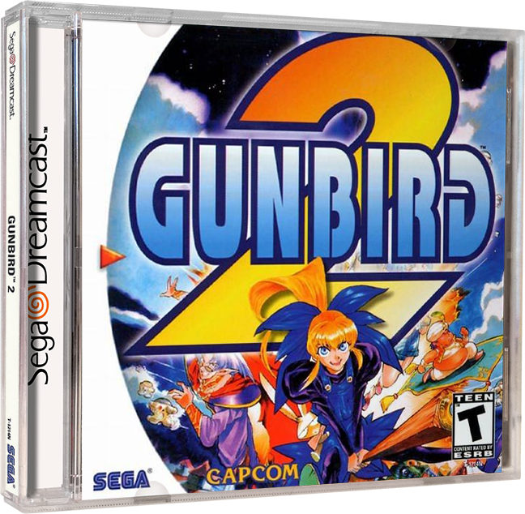
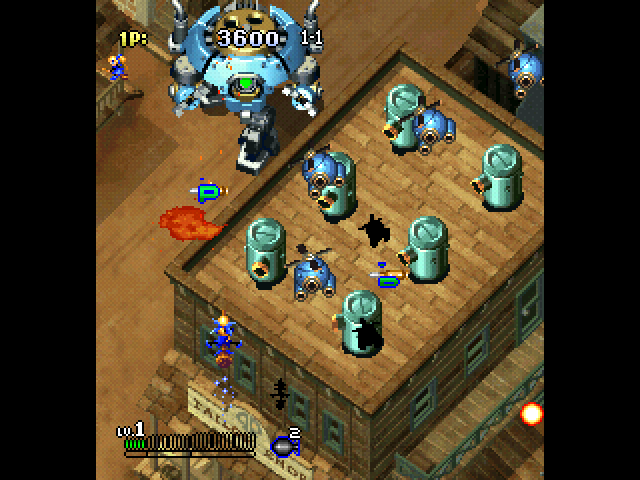
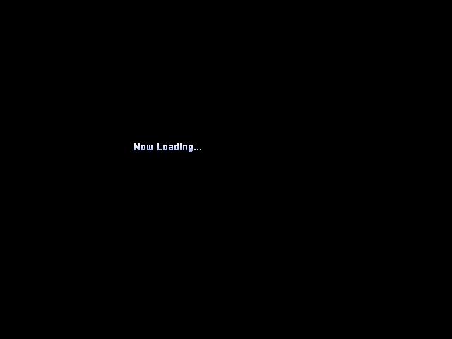
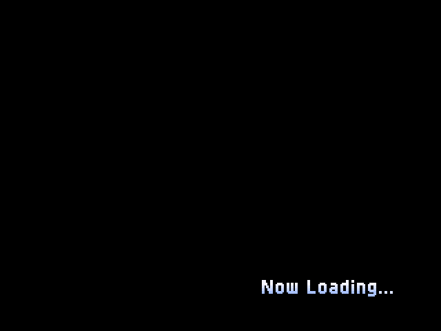
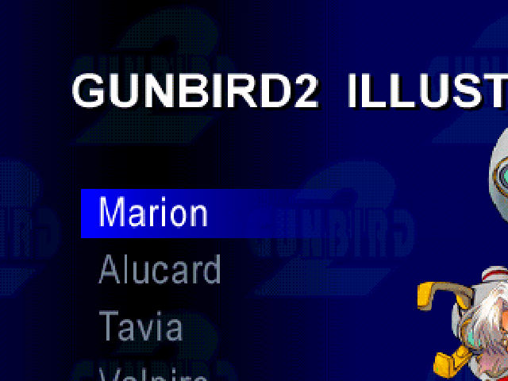
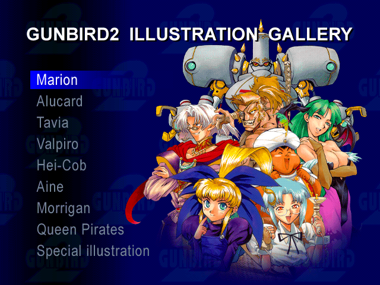

# Gunbird 2
A patch to fix the slowdown seen when playing "Gunbird 2" on the Sega Dreamcast in VGA mode. It also fixes two graphical bugs that only show up in VGA mode.

"Gunbird 2" didn't ship as a game officially supporting the VGA cable. However, players have been working around similar limitations with other games for years, either with boot discs, cable swapping, or more recently by simply forcing VGA mode with their ODEs (optical drive emulators).

That said, "Gunbird 2" is something of a special case. When forced into VGA mode, the game suffers everything from mild to incredible slowdown, some of which even introduces input lag. For these reasons, most consider the game unplayable in forced VGA mode.

The following changes can be observed with this patch applied (see the [About the Fix](#about-the-fix) section).

- The game runs at full speed in VGA mode, just as it does with a composite, S-Video, or RGB cable.
- The "Now Loading..." graphic appears at its proper size in the bottom-right corner of the screen. Previously, there were times in VGA mode when it was drawn at half size near the middle of the screen.
- The Gallery menu fits the screen in VGA mode. Previously, it was drawn at double size, leaving most of it off screen.
- The disc is flagged as VGA compatible and is region-free, so it boots with a VGA cable attached and no tricks are required.
- Dithering is switched off in VGA mode while a stage is being played, since dithering artifacts are now twice as large due to this patch's line-doubling method. Dithering is left on for every other screen as to not negatively impact the game's visual appearance with excessive color banding.

Nothing changes for those playing with a composite, S-Video, or RGB cable.

Note that those using DCHDMI/DCDigital/RetroGEM should set it to force VGA mode. When set to cable detect mode, the patched game locks up after the Capcom logo.

Download the patch (more information in the [Patching Instructions](#patching-instructions) section) for the North American version of "Gunbird 2".

- **GDI Format (Users of ODEs or Emulators)**
  - **Option 1**  
    Download [Gunbird 2 (VGA Slowdown Fix v1.0).dcp](https://github.com/DerekPascarella/Gunbird2-VGASlowdownFixDreamcast/releases/download/1.0/Gunbird.2.VGA.Slowdown.Fix.v1.0.dcp) for use with [Universal Dreamcast Patcher](https://github.com/DerekPascarella/UniversalDreamcastPatcher) v2.0 or newer.
  - **Option 2**  
    Download [Gunbird 2 (VGA Slowdown Fix v1.0) [GDI].xdelta](https://github.com/DerekPascarella/Gunbird2-VGASlowdownFixDreamcast/releases/download/1.0/Gunbird.2.VGA.Slowdown.Fix.v1.0.GDI.xdelta) for use with [Delta Patcher](https://www.romhacking.net/utilities/704/) (or equivalent tools).
- **CDI Format (Users Burning to CD-R)**  
  Download [Gunbird 2 (VGA Slowdown Fix v1.0) [CDI].xdelta](https://github.com/DerekPascarella/Gunbird2-VGASlowdownFixDreamcast/releases/download/1.0/Gunbird.2.VGA.Slowdown.Fix.v1.0.CDI.xdelta) for use with [Delta Patcher](https://www.romhacking.net/utilities/704/) (or equivalent tools).

## Table of Contents

1. [Patching Instructions](#patching-instructions)
2. [Credits](#credits)
3. [Release Changelog](#release-changelog)
4. [About the Game](#about-the-game)
5. [About the Fix](#about-the-fix)

## Patching Instructions
This patch supports the North American version of "Gunbird 2" only.

- **GDI Format (Users of ODEs or Emulators) - DCP Patch**  
  The DCP patch file shipped with this release is designed for use with [Universal Dreamcast Patcher](https://github.com/DerekPascarella/UniversalDreamcastPatcher) v2.0 or newer. Note that Universal Dreamcast Patcher supports TOSEC-style GDI, Redump-style CUE, and CHD disc images as source input.

  1. The **Apply Patch** tab is selected by default.
  2. Next to **Source disc image**, click "Browse..." and select the `.gdi`, `.cue`, or `.chd` to be patched.
  3. Next to **Patch file**, click "Browse..." and select the `.dcp` patch file.
  4. Next to **Output folder**, click "Browse..." and select the folder where the patched GDI should be written.
  5. Click **Apply Patch**.

- **GDI Format (Users of ODEs or Emulators) - XDelta Patch**  
  The XDelta patch file shipped with this release can be used with any number of Delta utilities, such as [Delta Patcher](https://www.romhacking.net/utilities/704/). It targets `track03.bin` of the original TOSEC GDI. Ensure the source `track03.bin` file has an MD5 checksum of `6D9A654E3BF6515A0B13FD4F38811CDB`.

  1. Click the settings icon (appears as a gear), enable **Checksum validation**, and disable **Backup original file**.
  2. Click the "Original file" browse icon and select the original `track03.bin` file.
  3. Click the "XDelta patch" browse icon and select the `Gunbird 2 (VGA Slowdown Fix v1.0) [GDI].xdelta` XDelta patch.
  4. Click "Apply patch" to overwrite the original `track03.bin` file with the patched version.
  5. Verify that the patched `track03.bin` file has an MD5 checksum of `13E4D42ADB205838DACCBFC35BE9C618`.

- **CDI Format (Users Burning to CD-R)**  
  The XDelta patch file shipped with this release can be used with any number of Delta utilities, such as [Delta Patcher](https://www.romhacking.net/utilities/704/). Ensure the source CDI has an MD5 checksum of `7B09143A3D990DD7A1EDD65741B3DFFF` (like the one found in the "DreamcastSelfBoot" repository).

  1. Click the settings icon (appears as a gear) and enable **Backup original file** and **Checksum validation**.
  2. Click the "Original file" browse icon and select the unmodified CDI.
  3. Click the "XDelta patch" browse icon and select the `Gunbird 2 (VGA Slowdown Fix v1.0) [CDI].xdelta` XDelta patch.
  4. Click "Apply patch" to generate the patched CDI in the same folder containing the original CDI.
  5. Verify that the patched CDI has an MD5 checksum of `BD3085BE1D1EA8FA254F8730E820F523`.

## Credits

- **Programming / Hacking**
  - Derek Pascarella (ateam)
- **Playtesting**
  - MikeRox
  - Shadowmask
  - sharewareeater

## Release Changelog

- **Version 1.0 (2026-11-24)**
  - Initial release.

## About the Game

<table>
 <tr>
  <td><b>Title</b></td>
  <td>Gunbird 2</td>
 </tr>
 <tr>
  <td><b>Developer</b></td>
  <td><a href="https://en.wikipedia.org/wiki/Psikyo">Psikyo</a></td>
 </tr>
 <tr>
  <td><b>Publisher</b></td>
  <td><a href="https://en.wikipedia.org/wiki/Capcom">Capcom</a></td>
 </tr>
 <tr>
  <td><b>Release Date</b></td>
  <td>2000-11-15</td>
 </tr>
 <tr>
  <td><b>Supported Peripherals</b></td>
  <td>Controller, Arcade Stick, Jump Pack, VMU, VGA Box (Unofficially)</td>
 </tr>
</table>

"Gunbird 2" is a vertically scrolling shoot-'em-up developed by Psikyo as the sequel to 1994's "Gunbird". Originally released in arcades in 1998 on the company's own SH2-based hardware, the game was ported to the Sega Dreamcast and published by Capcom, arriving in Japan on March 9th, 2000 and in North America that November. A European release from Virgin Interactive followed in 2001.

The story sends a cast of oddball adventurers after three elements, those of the Sun, the Moon, and the Stars. Whoever gathers all three is rewarded with the Almighty Potion, while a band of pirates known as the Queen Pirates does everything in its power to get there first.

The Dreamcast version's roster of seven includes two guest characters, Aine from Psikyo's own "Samurai Aces" series and Morrigan from Capcom's "Darkstalkers" series. Players can choose between two "Original" modes, one for a standard horizontal screen and one for a monitor rotated to a vertical (TATE) position, in addition to an "Arcade" mode. There's also a Gallery for viewing illustrations and preliminary artwork.

The game has since been re-released on the Nintendo Switch, Windows, PlayStation 4, and Xbox One.

## About the Fix

"Gunbird 2" is a 320x240 game. With a composite, S-Video, or RGB cable attached, it runs in 320x240 from start to finish, apart from the Capcom logo and the Gallery, both of which use 640x480. A VGA signal isn't meant to be 320x240, though. When the game sees a VGA cable, it sets the display to 640x480 and switches on a flag that tells its own drawing code to draw everything at double size.

What's known for certain is that doubling the width and height of every sprite and background tile leaves the console's PowerVR graphics chip with four times as many pixels to fill as it has to in non-VGA mode. It's also known that, at least in the first stage, the game submits everything it draws as translucent polygons, which are the most expensive kind for the chip to draw. Measured in an emulator during that stage, the polygons add up to roughly 180,000 pixels per frame on a TV, and anywhere from 670,000 to 990,000 in VGA mode.

The likely cause of the slowdown, then, is that the chip can't finish drawing the busier frames in time. The game waits for each frame to finish instead of skipping it, which would explain why players see slow motion and not dropped frames. Note that this was never measured directly on real hardware, and emulators don't reproduce the slowdown at all, since they don't account for how long the chip takes to draw a frame. What can be said is that the slowdown goes away once the game stops drawing at double size.

The two graphical bugs are tied to the same doubling. The Gallery already draws its menu for a 640x480 screen, so with the flag left on, the menu comes out twice as big as it should and most of it ends up off screen. The "Now Loading..." graphic has the opposite problem. After the Capcom logo, and again when leaving the Gallery, it's drawn without any doubling at all, so it shows up at half size near the middle of the screen. Why the doubling is missed at those two points wasn't tracked down, as nothing is doubled anymore with this patch applied.

<table>
 <tr>
  <td align="center"><b>Original</b></td>
  <td align="center"><b>Patched</b></td>
 </tr>
 <tr>
  <td></td>
  <td></td>
 </tr>
 <tr>
  <td></td>
  <td></td>
 </tr>
</table>

With this patch, the game renders 320x240 in VGA mode exactly as it does in non-VGA mode, and the console's video hardware stretches that picture to 640x480 on its way out. The PowerVR chip has two settings for this. Line double sends every line of the picture twice, and pixel double sends every pixel twice. The monitor receives the same 640x480 signal as before, with the same timings, but the chip only has to draw a quarter of the pixels.

It starts with the game's boot code, which now asks for 320x240 on a VGA cable and leaves the double-size flag off.

```
             original                  patched
8C01F024     mov  #0x31, r4            mov  #0x01, r4        ; VGA 640x480 becomes VGA 320x240
8C01F02C     mov  #1, r3               mov  #0, r3           ; double-size flag off
```

That alone isn't enough, because the SEGA libraries the game is built on won't set up anything other than 640x480 when a VGA cable is attached. Ninja throws away the requested size for VGA in two places, and Kamui's `kmSetDisplayMode` has a special case that does the same. All three were patched out. One more Kamui routine was adjusted so that a 240-line VGA picture gets its eighth row of 32-pixel tiles, as 240 lines works out to seven and a half rows.

The line double and pixel double settings are switched on by a small new routine that wraps `kmSetDisplayMode`. Kamui keeps its own copies of the video registers and writes them to the hardware itself, so the new routine only has to set the two bits in those copies.

```
SetDisplayModeVGA:                     ; r4 = display mode
    sts.l  pr, @-r15
    mov.l  r4, @-r15
    mov.l  kmSetDisplayMode, r3
    jsr    @r3                         ; Kamui sets the mode up as usual
    nop
    mov.l  @r15+, r7
    mov    r0, r6
    mov    r7, r0
    tst    #1, r0                      ; VGA mode?
    bt     done
    tst    #32, r0                     ; fewer than 480 lines?
    bf     check_width
    mov.l  FB_R_CTRL_copy, r2
    mov.l  @r2, r0
    or     #2, r0                      ; line double
    mov.l  r0, @r2
check_width:
    mov    r7, r0
    tst    #16, r0                     ; fewer than 640 pixels across?
    bf     done
    mov.l  VO_CONTROL_copy, r2
    mov.l  @r2, r0
    mov.w  pixel_double, r1            ; 0x0100
    or     r1, r0
    mov.l  r0, @r2
done:
    mov    r6, r0
    lds.l  @r15+, pr
    rts
    nop
```

Lastly, the routine the game calls when switching to and from 640x480 was rewritten. On a VGA cable it used to ignore the requested size and set 640x480 with the double-size flag on every time. It now sets 320x240 or true 640x480 to match the request, with the flag always off. This fixes the Gallery menu, and with nothing being doubled by the game anymore, the "Now Loading..." graphic displays correctly too.

Rendering at 320x240 does have one side effect. The game has the PowerVR chip dither its picture, which scatters a fine pattern of dots across it to hide the limited number of colors a 16-bit frame buffer can hold. In the original VGA mode, that pattern was applied to a 640x480 picture. With this patch, it's applied to a 320x240 picture that's then stretched, so every dot ends up as a much more noticeable block of four pixels.

Dithering is a single setting that's either on or off for a whole frame, and the chip has no means of making the pattern finer or weaker. Switching it off altogether was tried first. Stages looked clean that way, but other screens looked noticeably worse due to color banding that dithering must be used to hide.

Instead, a second new routine decides frame by frame. It runs in place of Kamui's `kmRender`, and then jumps to it. If line double is on, which is only the case for 320x240 in VGA mode, it switches dithering off while a stage is being played and back on for everything else. That includes the dialogue scenes that interrupt a stage, as dithering stays on for as long as the character portraits are on screen. The Capcom logo and the Gallery are left alone, since their native 640x480 picture isn't stretched.

The game doesn't appear to keep one variable that says which screen is being shown, so the routine reads two separate RAM values at once. The first is left at 7 on every frame of a stage and set back to 8 once the stage is over. The second is 2 while the dialogue portraits are displayed.

```
RenderFrame:
    mov.l  FB_R_CTRL_copy, r1
    mov.l  @r1, r0
    tst    #2, r0                      ; line double on?
    bt     render
    mov.l  FB_W_CTRL_copy, r1
    mov.l  @r1, r0
    or     #8, r0                      ; dither on
    mov.l  stage_value, r2             ; 0x8C2866FC
    mov.w  @r2, r2
    mov    #7, r3
    cmp/eq r3, r2                      ; stage being played?
    bf     store
    mov.l  dialogue_value, r2          ; 0x8C2863D8
    mov.w  @r2, r2
    mov    #2, r3
    cmp/eq r3, r2                      ; dialogue portraits on screen?
    bt     store
    xor    #8, r0                      ; dither off
store:
    mov.l  r0, @r1
render:
    mov.l  kmRender, r1
    jmp    @r1
    nop
```
